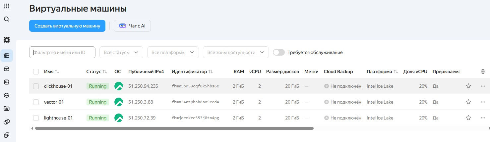
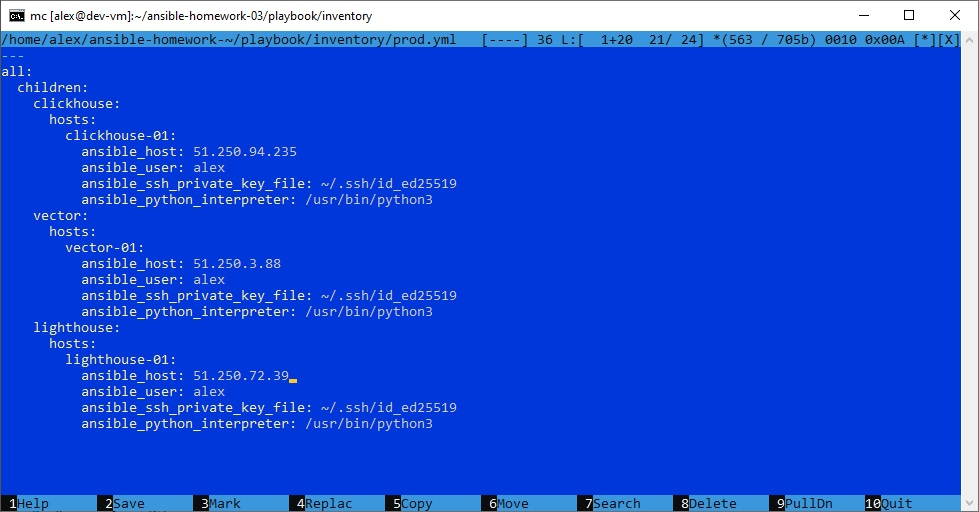
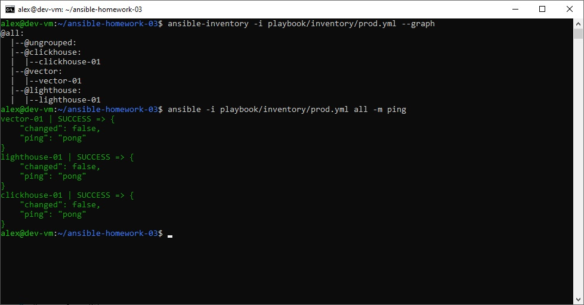
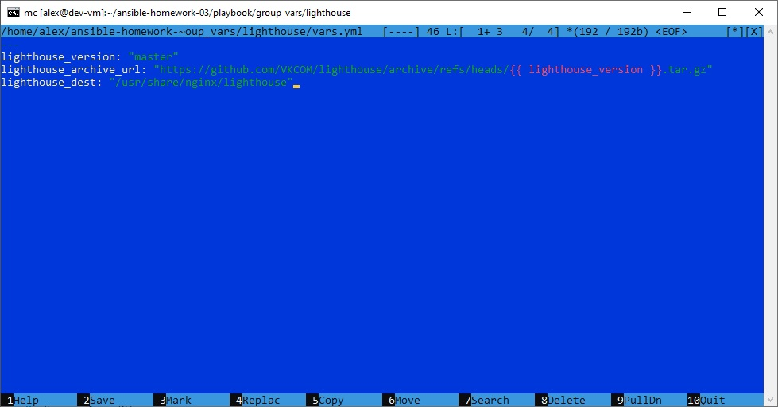
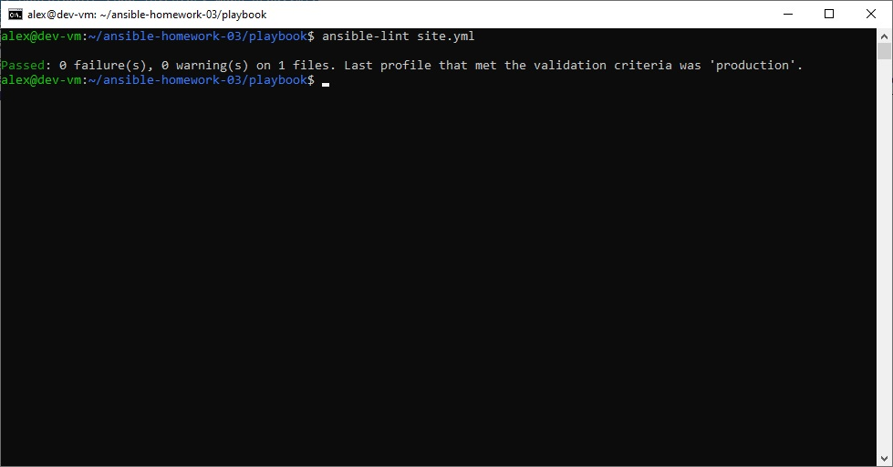
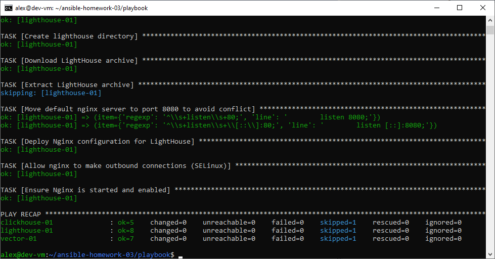
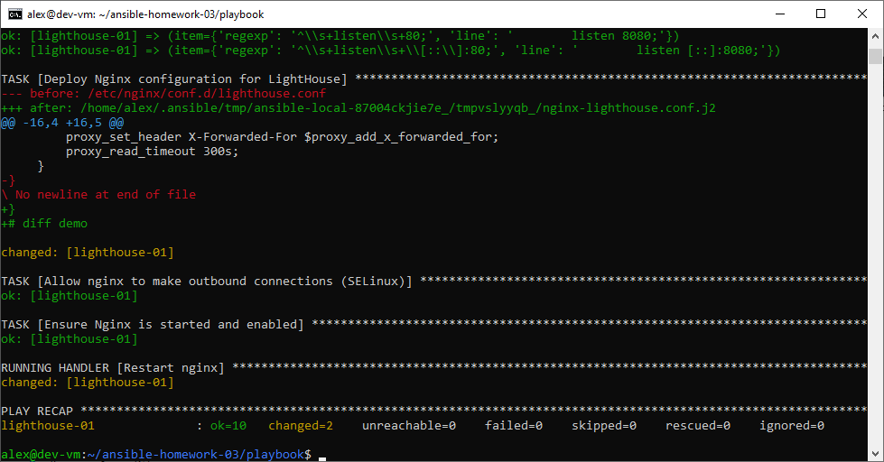
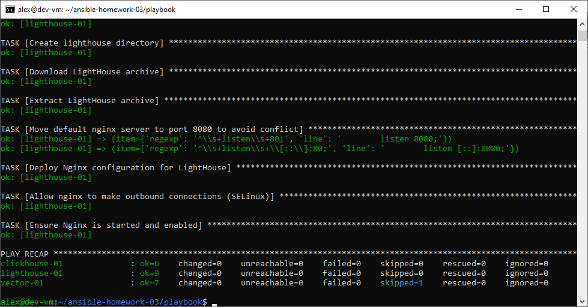
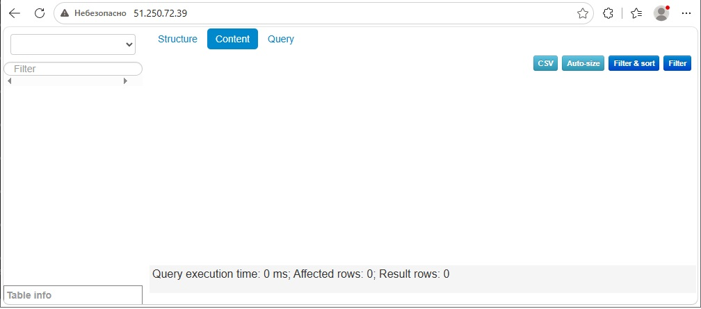

# Домашнее задание к занятию 3 «Использование Ansible»

## 📖 О чём этот playbook

Playbook автоматизирует установку и настройку трёх сервисов на серверах под управлением **Rocky Linux 9** в Yandex Cloud:

- **ClickHouse** — установка из официальных RPM, настройка `listen_host` (0.0.0.0), создание базы данных `logs`.
- **Vector** — скачивание с GitHub Releases, распаковка, установка бинарника, деплой конфигурации через Jinja2, systemd-сервис.
- **LightHouse** — установка Nginx, скачивание статики из [VKCOM/lighthouse](https://github.com/VKCOM/lighthouse), распаковка, деплой конфига nginx с проксированием `/clickhouse/` к ClickHouse, запуск веб-сервера.

В соответствии с требованиями задания используются модули **`get_url`, `template`, `dnf`, `file`, `unarchive`, `lineinfile`, `systemd`, `ansible.posix.seboolean`**.

## 🖥️ Окружение

- **Control node:** Debian 13, Ansible установлен через `sudo apt install ansible` (`ansible-core` 2.19+).
- **Managed hosts** — три VM в Yandex Cloud на Rocky Linux 9:



| Хост | Группа | Роль | Публичный IP |
|---|---|---|---|
| `clickhouse-01` | `clickhouse` | ClickHouse-сервер | `51.250.94.235` |
| `vector-01` | `vector` | Vector-агент | `51.250.3.88` |
| `lighthouse-01` | `lighthouse` | LightHouse (Nginx) | `51.250.72.39` |

- Доступ по SSH с ключом `~/.ssh/id_ed25519`, пользователь `alex`.

## 📂 Структура репозитория

```
ansible-homework-03/
├── README.md
├── images/                              # скриншоты выполнения заданий №5–8
│   ├── 1.jpg
│   ├── 6-check.png
│   ├── 7-diff.png
│   └── 8-idempotent.png
└── playbook/
    ├── site.yml                         # 3 play: ClickHouse, Vector, LightHouse
    ├── inventory/
    │   └── prod.yml                     # inventory с тремя группами
    ├── group_vars/
    │   ├── clickhouse/
    │   │   └── vars.yml                 # версия, пакеты, listen_host
    │   ├── vector/
    │   │   └── vars.yml                 # версия, URL, пути
    │   └── lighthouse/
    │       └── vars.yml                 # ветка/URL, каталог статики
    └── templates/
        ├── vector.yml.j2                # конфиг Vector
        ├── vector.service.j2            # systemd-unit Vector
        └── nginx-lighthouse.conf.j2     # конфиг nginx для LightHouse
```

## 📝 Inventory (`playbook/inventory/prod.yml`)

```yaml
---
all:
  children:
    clickhouse:
      hosts:
        clickhouse-01:
          ansible_host: 51.250.94.235
          ansible_user: alex
          ansible_ssh_private_key_file: ~/.ssh/id_ed25519
    vector:
      hosts:
        vector-01:
          ansible_host: 51.250.3.88
          ansible_user: alex
          ansible_ssh_private_key_file: ~/.ssh/id_ed25519
    lighthouse:
      hosts:
        lighthouse-01:
          ansible_host: 51.250.72.39
          ansible_user: alex
          ansible_ssh_private_key_file: ~/.ssh/id_ed25519
```





## ⚙️ Параметры (переменные)

### ClickHouse (`group_vars/clickhouse/vars.yml`)

| Переменная | Описание | Значение |
|---|---|---|
| `clickhouse_version` | Версия ClickHouse | `"24.8.5.115"` |
| `clickhouse_packages` | Список пакетов | `[clickhouse-client, clickhouse-server, clickhouse-common-static]` |
| `clickhouse_listen_host` | Адрес, на котором слушает ClickHouse | `"0.0.0.0"` |

### Vector (`group_vars/vector/vars.yml`)

| Переменная | Описание | Значение |
|---|---|---|
| `vector_version` | Версия Vector | `"0.61.0"` |
| `vector_archive` | Имя архива | `vector-{{ vector_version }}-x86_64-unknown-linux-gnu.tar.gz` |
| `vector_download_url` | URL для скачивания | `https://github.com/vectordotdev/vector/releases/download/v{{ vector_version }}/{{ vector_archive }}` |
| `vector_install_dir` | Каталог установки | `/opt/vector` |
| `vector_bin` | Путь к бинарнику после распаковки | `{{ vector_install_dir }}/vector-x86_64-unknown-linux-gnu/bin/vector` |

### LightHouse (`group_vars/lighthouse/vars.yml`)

| Переменная | Описание | Значение |
|---|---|---|
| `lighthouse_version` | Ветка/тег репозитория VKCOM/lighthouse | `"master"` |
| `lighthouse_archive_url` | URL архива | `https://github.com/VKCOM/lighthouse/archive/refs/heads/{{ lighthouse_version }}.tar.gz` |
| `lighthouse_dest` | Каталог статики | `/usr/share/nginx/lighthouse` |



## 🏷️ Теги

| Тег | Что выполняется |
|---|---|
| `clickhouse` | Все задачи play для ClickHouse |
| `vector` | Все задачи play для Vector |
| `lighthouse` | Все задачи play для LightHouse |
| `install` | Задачи установки (скачивание, распаковка, установка пакетов, создание каталогов) |
| `configure` | Задачи настройки (деплой конфигов, создание БД, запуск сервисов, SELinux) |

**Примеры:**

```bash
# Только ClickHouse
ansible-playbook -i inventory/prod.yml site.yml --tags clickhouse

# Только установка (без конфигурации)
ansible-playbook -i inventory/prod.yml site.yml --tags install

# Только настройка LightHouse
ansible-playbook -i inventory/prod.yml site.yml --tags lighthouse,configure

# Всё, кроме конфигурации
ansible-playbook -i inventory/prod.yml site.yml --skip-tags configure
```

## 🚀 Использование

### 1. Подготовка inventory

Отредактируйте `playbook/inventory/prod.yml` — укажите IP-адреса своих ВМ.

### 2. Линтинг

```bash
cd playbook
ansible-lint site.yml
```

Ожидаемый результат: `Passed: 0 failure(s), 0 warning(s)`.

### 3. Пробный прогон (`--check`)

```bash
ansible-playbook -i inventory/prod.yml site.yml --check
```

Ничего не изменяет — только показывает, что было бы сделано.

### 4. Прогон с диффом (`--diff`)

```bash
ansible-playbook -i inventory/prod.yml site.yml --diff
```

Показывает изменения в файлах (для задач `template`, `copy`, `lineinfile`).

### 5. Полный прогон

```bash
ansible-playbook -i inventory/prod.yml site.yml
```

### 6. Проверка на хостах

```bash
# ClickHouse
ssh alex@51.250.94.235 "sudo ss -tlnp | grep 8123; clickhouse-client -q 'SHOW DATABASES'"

# Vector
ssh alex@51.250.3.88 "sudo systemctl status vector --no-pager | head -5; vector validate /etc/vector/vector.yaml"

# LightHouse
ssh alex@51.250.72.39 "sudo systemctl status nginx --no-pager | head -5"
curl -s http://51.250.72.39/ | grep -i "<title>"
curl -s "http://51.250.72.39/clickhouse/?query=SELECT%20version()"
```

## 🔍 Что делает playbook

### Play 1. Install ClickHouse (`hosts: clickhouse`)

1. `get_url` — скачивает RPM-пакеты `clickhouse-client`, `clickhouse-server`, `clickhouse-common-static` версии `24.8.5.115`.
2. `dnf` — устанавливает их (`disable_gpg_check: true`, т.к. RPM не подписаны).
3. `copy` — деплоит `/etc/clickhouse-server/config.d/listen.xml` с `<listen_host>0.0.0.0</listen_host>` (чтобы ClickHouse принимал внешние подключения от LightHouse).
4. `service` — handler `Start clickhouse service` перезапускает `clickhouse-server` при изменении пакетов или конфига.
5. `command` — создаёт базу `logs` (идемпотентно: `failed_when: rc not in (0, 82)`, `changed_when: rc == 0`).

### Play 2. Install and configure Vector (`hosts: vector`)

1. `file` — создаёт каталоги `/opt/vector`, `/etc/vector`, `/var/lib/vector`.
2. `get_url` — скачивает `.tar.gz` с GitHub Releases.
3. `unarchive` — распаковывает в `/opt/vector` (`remote_src: true`, `creates: {{ vector_bin }}` — идемпотентность).
4. `file` — создаёт симлинк `/usr/local/bin/vector → {{ vector_bin }}` (`follow: false`).
5. `template` — деплоит `/etc/vector/vector.yaml` из `templates/vector.yml.j2`.
6. `template` — деплоит `/etc/systemd/system/vector.service` из `templates/vector.service.j2`.
7. `systemd` — запускает и включает сервис.

**Handler `Restart vector service`** срабатывает при изменении конфига или unit.

### Play 3. Install and configure LightHouse (`hosts: lighthouse`)

1. `dnf` — устанавливает `nginx`.
2. `file` — создаёт каталог `/usr/share/nginx/lighthouse`.
3. `get_url` — скачивает архив `VKCOM/lighthouse` (`master`).
4. `unarchive` — распаковывает с `--strip-components=1` в `lighthouse_dest`.
5. `lineinfile` — переносит дефолтный `server` nginx с порта 80 на 8080 (устраняет конфликт `conflicting server name "_"`).
6. `ansible.posix.seboolean` — включает `httpd_can_network_connect` для SELinux (без этого nginx не может проксировать запросы к ClickHouse и отдаёт **502 Bad Gateway**).
7. `template` — деплоит `/etc/nginx/conf.d/lighthouse.conf` из `templates/nginx-lighthouse.conf.j2`:
   - `root` на `{{ lighthouse_dest }}`;
   - `try_files` для SPA;
   - `location /clickhouse/` → `proxy_pass http://{{ hostvars['clickhouse-01']['ansible_host'] }}:8123/`.
8. `systemd` — запускает и включает `nginx`.

**Handler `Restart nginx`** срабатывает при изменении конфига.

### Почему SELinux важен

На Rocky Linux 9 по умолчанию `httpd_can_network_connect = off`, и nginx-воркеру запрещено открывать исходящие TCP-соединения. При попытке проксирования к ClickHouse в `/var/log/nginx/error.log` появляется:

```
connect() to 51.250.94.235:8123 failed (13: Permission denied) while connecting to upstream
```

Включение `httpd_can_network_connect` решает проблему. В playbook это закреплено задачей `ansible.posix.seboolean` — воспроизводится при пересоздании VM.

## 🖼️ Скриншоты выполнения заданий №5–8

### Пункт 5. `ansible-lint site.yml` — 0 ошибок



### Пункт 6. `--check` — план без изменений



### Пункт 7. `--diff` — изменения применены



### Пункт 8. Повторный `--diff` — идемпотентность (`changed=0`)



## ✅ Идемпотентность

Playbook идемпотентен: повторный запуск с `--diff` даёт `changed=0` для всех трёх хостов (`clickhouse-01`, `vector-01`, `lighthouse-01`). Handler'ы не запускаются без фактических изменений.

Механизмы идемпотентности:
- `get_url` не перекачивает существующие файлы (если размер/checksum совпадают);
- `unarchive` с `creates` пропускает распаковку, если бинарник уже есть;
- `lineinfile` не меняет строку, если она уже соответствует `line`;
- `template` не помечает задачу `changed`, если содержимое файла не изменилось;
- `ansible.posix.seboolean` с `persistent: true` идемпотентен: если boolean уже `on`, задача `ok`;
- `command` для создания БД имеет `failed_when`/`changed_when`, корректно обрабатывая код 82 («БД уже существует»).

## 📋 Требования

- Ansible 2.10+ (`ansible-core` 2.19 проверен).
- Коллекция `ansible.posix` (для `seboolean`): `ansible-galaxy collection install ansible.posix`.
- `ansible-lint` для проверки.
- SSH-доступ к трём хостам Rocky Linux 9.
- Python 3 на управляемых хостах.
- Открытые порты в Security Group Yandex Cloud:
  - `22` (SSH) — для всех ВМ;
  - `8123` (ClickHouse HTTP) — для `clickhouse-01`;
  - `80` (HTTP) — для `lighthouse-01`.

## 📌 Примечания и известные особенности

- **ClickHouse RPM не подписаны** — используется `disable_gpg_check: true` в задаче `dnf`.
- **`listen_host` в ClickHouse** — по умолчанию слушает `127.0.0.1`. Задача `copy` в `/etc/clickhouse-server/config.d/listen.xml` расширяет до `0.0.0.0`, что необходимо для проксирования из LightHouse.
- **Vector `unarchive`** использует каталог без версии в имени (`vector-x86_64-unknown-linux-gnu`) — это особенность архивов Vector с GitHub Releases. `vector_bin` учитывает это.
- **SELinux на Rocky 9** блокирует исходящие соединения nginx — задача `seboolean` обязательна для работы прокси `/clickhouse/`.
- **`vector validate`** в версии 0.61.0 не принимает `--config` — используйте позиционный аргумент: `vector validate /etc/vector/vector.yaml`.

## 🔗 Проверка LightHouse



1. Открыть в браузере: `http://51.250.72.39/` — интерфейс LightHouse.
2. В настройках LightHouse указать ClickHouse URL: `http://51.250.72.39/clickhouse/`.
3. Выполнить запрос, например `SHOW DATABASES` — LightHouse отобразит список БД ClickHouse (`default`, `logs`, `system`).
4. Проверка прокси через `curl`:

```bash
curl -s "http://51.250.72.39/clickhouse/?query=SELECT%20version()"
# → 24.8.5.115
```

- **Репозиторий:** https://github.com/akamsoft/ansible-homework-03
